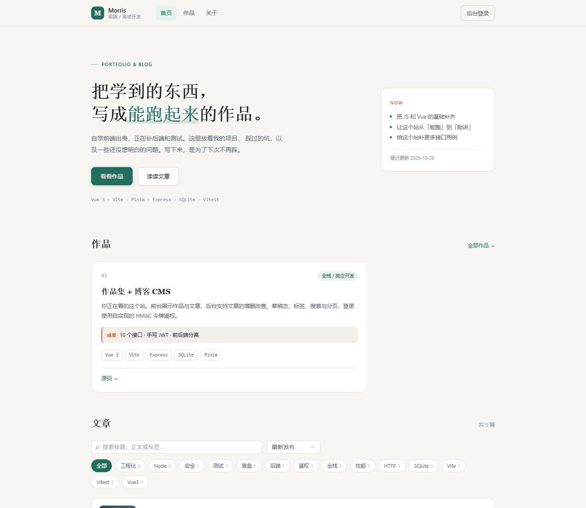
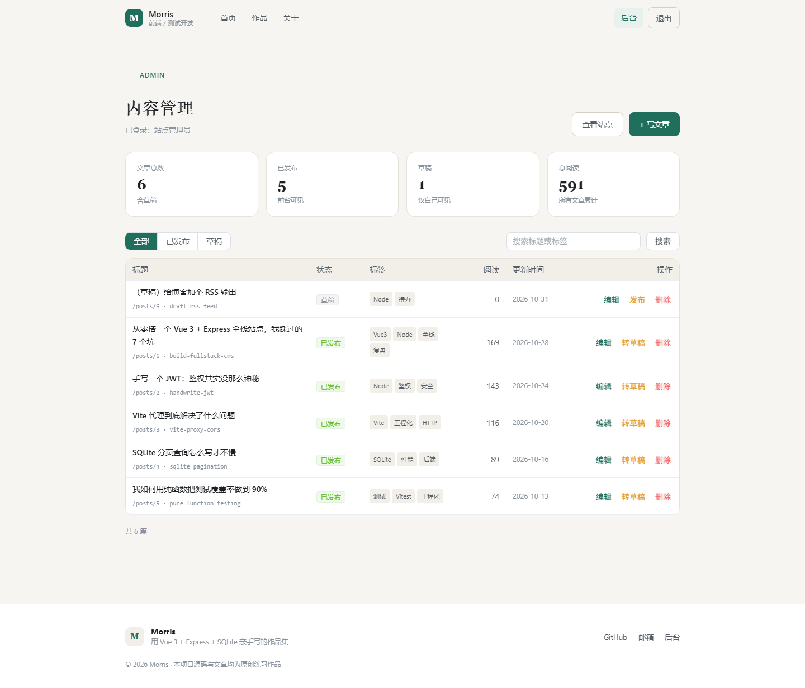
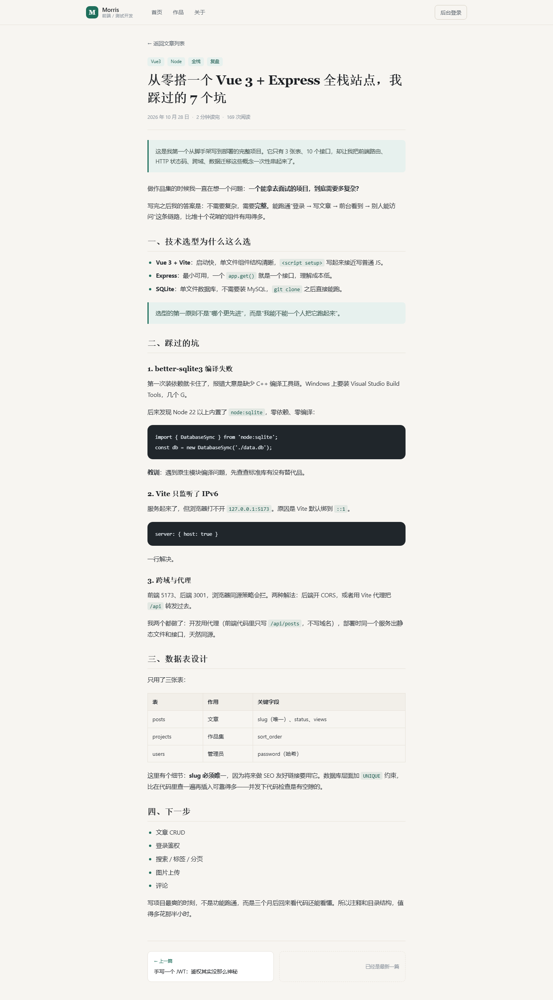

# 作品集 + 博客 CMS

一个可以真正写完、部署上线、并且能对着代码讲清楚的全栈项目。

前台是作品展示与技术博客，后台是带登录的文章管理。前端 Vue 3，后端 Express，
数据存 SQLite 单文件库，鉴权用 Node 内置 `crypto` 手写的 HMAC 令牌——没有 jsonwebtoken、
没有 bcrypt，目的就是把「鉴权到底在干什么」摊开看。



## 目录

- [功能](#功能)
- [技术栈](#技术栈)
- [快速开始](#快速开始)
- [目录结构](#目录结构)
- [接口一览](#接口一览)
- [测试](#测试)
- [几个设计决策](#几个设计决策)
- [部署](#部署)
- [已知限制 & 下一步](#已知限制--下一步)

## 功能

**前台**

- 首页：个人简介、作品精选、文章列表
- 文章列表：关键词搜索（标题/摘要/正文/标签）、标签筛选、排序（最新/最热/最早）、分页
- 文章详情：Markdown 渲染、阅读量统计、上一篇/下一篇
- 作品页、关于页、404 页
- 全站响应式，移动端可用

**后台**（需登录）

- 登录页：表单校验、错误提示、防暴力破解（5 次/分钟）
- 仪表盘：文章总数 / 已发布 / 草稿 / 总阅读
- 文章表格：按状态筛选、搜索、分页
- 文章编辑器：标题 / slug / 标签 / 摘要 / 正文，Markdown 实时预览
- 一键发布与转草稿、删除二次确认、未保存离开提醒

**工程化**

- 接口测试 36 条（Node 内置 test runner，零依赖）
- 前端单测 44 条（Vitest，覆盖纯函数与边界情况）
- 生产构建分包：Vue / Element Plus / Markdown 各自独立 chunk
- 内容与代码分离：文章是 `content/posts/*.md` 文件，seed 时读目录

| 后台 | 详情页 |
|---|---|
|  |  |

## 技术栈

| 层 | 选型 | 说明 |
|---|---|---|
| 前端 | Vue 3 + Vite | `<script setup>` 单文件组件 |
| 路由 / 状态 | Vue Router 4 + Pinia | 路由守卫做后台拦截，Pinia 管登录态 |
| UI | Element Plus + 手写 CSS | 组件库负责表单表格，排版自己写 |
| 请求 | Axios | 统一实例 + 请求/响应拦截器 |
| 渲染 | marked + DOMPurify | Markdown → HTML，再消毒防 XSS |
| 后端 | Node + Express 4 | 按资源拆路由 |
| 数据库 | `node:sqlite` | Node 内置，免编译 |
| 鉴权 | `node:crypto` | scrypt 哈希 + HMAC-SHA256 令牌 |

## 快速开始

要求：**Node 22+**（`node:sqlite` 内置；Node 26 下无需任何实验参数）。

```bash
# 1. 后端
cd backend
npm install
npm run dev          # http://localhost:3001

# 2. 前端（另开一个终端）
cd frontend
npm install
npm run dev          # http://localhost:5173
```

打开 <http://localhost:5173> 即可。

首次启动会自动建表并灌入演示数据（6 篇文章 + 1 个作品 + 管理员账号），
已有数据时不会重复插入。想从空库开始：删掉 `backend/data.db` 再启动。

**默认账号**：`admin` / `admin123`
（想改就设环境变量 `ADMIN_USER` / `ADMIN_PASS` 后删库重启，或改 `backend/src/seed.js`。）

> 生产环境务必设置 `JWT_SECRET`，否则用的是代码里的开发默认值。

## 目录结构

```
portfolio-cms/
├── backend/
│   ├── src/
│   │   ├── index.js          程序入口：初始化数据 + 启动
│   │   ├── app.js            组装 Express（不含 listen，方便测试）
│   │   ├── db.js             建表、迁移、导出连接
│   │   ├── auth.js           密码哈希 / 令牌签发校验 / 中间件
│   │   ├── seed.js           读 content/ 灌初始数据
│   │   └── routes/
│   │       ├── posts.js      文章 CRUD + 搜索分页
│   │       ├── projects.js   作品集
│   │       ├── auth.js       登录、当前用户
│   │       ├── tags.js       标签聚合
│   │       └── stats.js      后台统计
│   ├── content/
│   │   ├── posts/*.md        文章正文（front matter + Markdown）
│   │   └── projects.json     作品集数据
│   ├── test/api.test.js      36 条接口测试
│   └── api.http              REST Client 请求样例
└── frontend/
    ├── src/
    │   ├── api/index.js      所有请求的唯一出口
    │   ├── stores/auth.js    登录态
    │   ├── router/index.js   路由表 + 守卫
    │   ├── components/       SiteHeader / SiteFooter / PostCard / ProjectCard
    │   ├── views/            Home / Projects / PostDetail / About / NotFound
    │   │   └── admin/        Login / Dashboard / PostEditor
    │   ├── utils/            date / format / markdown（纯函数，被单测覆盖）
    │   └── styles/main.css   设计变量 + 全局排版
    └── test/                 Vitest 单测
```

## 接口一览

| 方法 | 路径 | 登录 | 说明 |
|---|---|---|---|
| GET | `/api/health` | — | 健康检查 |
| POST | `/api/auth/login` | — | 登录，返回 8 小时令牌 |
| GET | `/api/auth/me` | ✅ | 用令牌换用户信息 |
| GET | `/api/posts` | 可选 | 列表；支持 `q` `tag` `status` `sort` `page` `pageSize` |
| GET | `/api/posts/:id` | 可选 | 详情；含上一篇/下一篇，累加阅读量 |
| POST | `/api/posts` | ✅ | 新建；slug 与摘要可自动生成 |
| PUT | `/api/posts/:id` | ✅ | 局部更新，只改传了的字段 |
| DELETE | `/api/posts/:id` | ✅ | 删除 |
| GET | `/api/tags` | — | 标签及文章数 |
| GET | `/api/projects` | — | 作品列表 |
| POST/PUT/DELETE | `/api/projects/…` | ✅ | 作品维护 |
| GET | `/api/stats` | ✅ | 后台统计 |

状态码约定：`200` 成功、`201` 创建成功、`400` 参数不合法、
`401` 未登录/令牌失效、`404` 资源不存在、`409` 唯一约束冲突（slug 重复）、
`429` 登录尝试过多、`500` 服务端异常。

**未登录时列表只返回已发布文章，草稿详情直接 404**——外部人猜到 id 也读不到没写完的内容。

## 测试

```bash
cd backend  && npm test    # 36 passed —— 接口：鉴权、CRUD、校验、分页、搜索、注入、错误处理
cd frontend && npm test    # 44 passed —— 纯函数：空值、边界、emoji、时区
```

后端测试用 `:memory:` 内存库，跑完即弃，不污染 `data.db`。

## 几个设计决策

**为什么把 `app.js` 和 `index.js` 拆开？**
`app.js` 只负责组装、不 `listen`。测试时 import 它并监听随机端口，跑测试不会占用你的 3001。

**为什么手写 JWT 而不用库？**
库当然更好（会处理更多边界），但手写一遍才知道「三段 Base64 + 一次 HMAC」是什么，
也才知道为什么 payload 不能放敏感信息——它只是编码，不是加密。

**为什么文章存 Markdown 文件而不是数据库？**
写作时不用在 JS 字符串里转义反引号；想加一篇就是新建一个 `.md`。数据库只存"运行时改的内容"。
这也是很多静态站生成器的思路。

**为什么排序字段要用白名单？**
`ORDER BY ${req.query.sort}` 是经典注入点——SQL 的 `ORDER BY` 不能用占位符传列名。
所以只允许 `newest / oldest / popular / title` 四个值，其余一律回落到默认。

**为什么前端要 DOMPurify？**
文章内容最终走 `v-html`。如果内容里有 ``，浏览器会真执行。
消毒后只保留安全的排版标签。

## 部署

项目支持**单服务模式**：构建前端后，Express 会顺手托管 `frontend/dist`，
前后端同源，不需要额外配置 CORS 或反向代理。

```bash
cd frontend && npm run build   # 产出 frontend/dist
cd ../backend && NODE_ENV=production npm start
# 打开 http://localhost:3001 —— 页面和接口都在这个端口
```

已处理的细节：SPA 深链接回退（`/posts/1` 直接刷新不会 404）、
带扩展名的静态资源找不到时返回真 404 而不是 index.html。

免费部署可选 Render / Railway（Node 服务），注意 SQLite 文件在部分平台是临时的，
需要挂持久磁盘。

## 已知限制 & 下一步

- 图片上传还没做（现在文章封面用标题生成的渐变色块）
- 评论、RSS、文章归档页未做
- Element Plus 整包引入，体积 940KB（gzip 303KB）。下一步换按需引入可以压到 1/4
- 没有刷新令牌，令牌过期就得重新登录
- SQLite 单机够用，多实例部署要换 Postgres

## License

MIT
